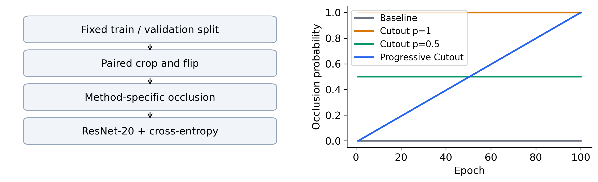
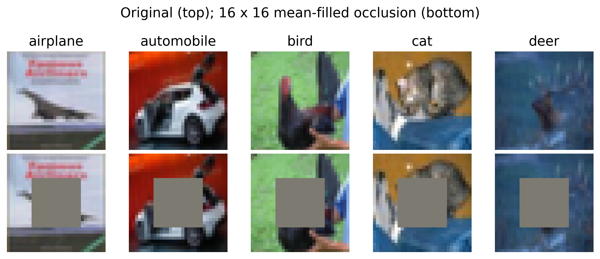
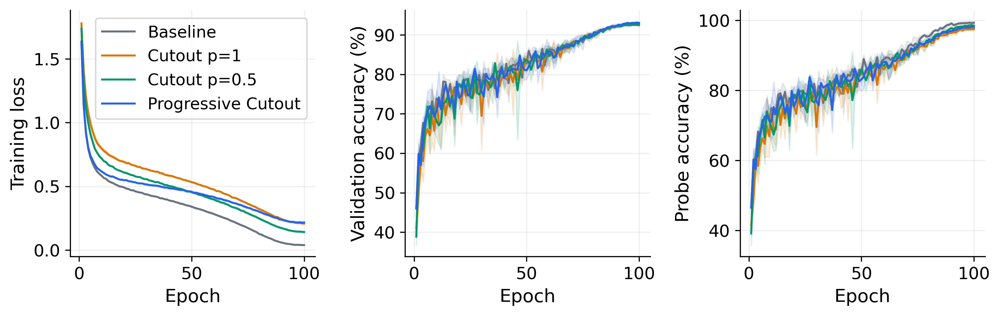
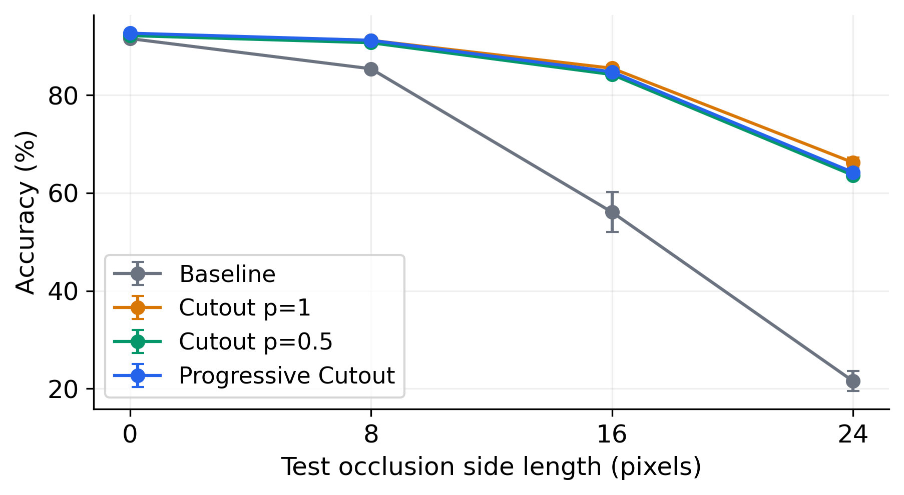
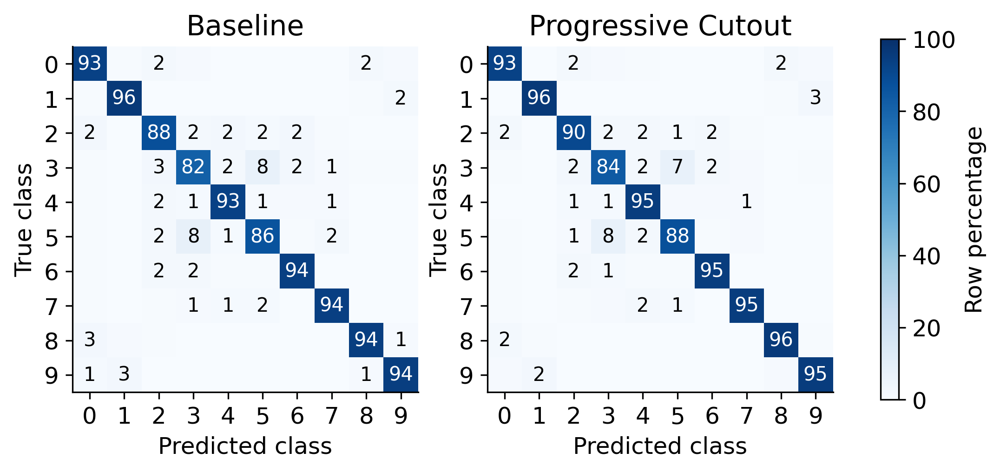
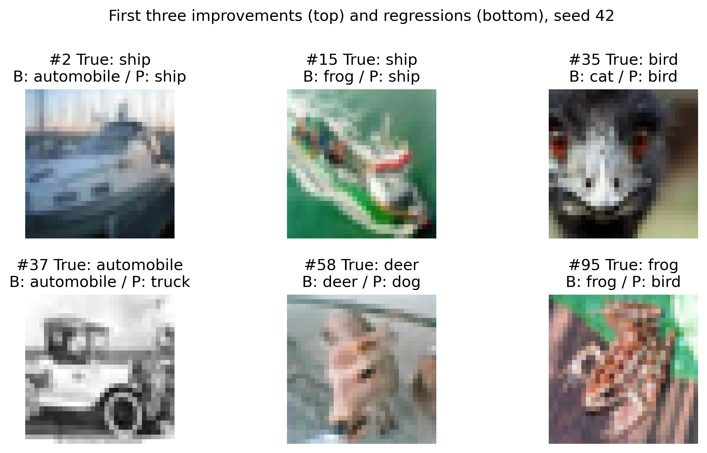

# 渐进式随机遮挡对图像分类性能的影响

基于 CIFAR-10 的复现与分析

刘凌霄

华北电力大学

**摘要** 随机遮挡是一种实现简单的数据增强方法，但其训练强度及时间顺序的作用容易混淆。本文复现 Cutout，并在 CIFAR-10 上研究遮挡概率随训练轮次线性递增的方案。采用无预训练的 CIFAR ResNet-20，将原训练集固定划分为45000张训练图像和5000张验证图像，比较无遮挡基线、始终遮挡、固定概率0.5及渐进概率四组策略，每组以三个随机种子训练100轮。固定概率组与渐进组具有相同的平均期望遮挡概率，用于控制增强总量。渐进方案的干净测试准确率为92.63 ± 0.05%，人工遮挡平均准确率为80.04 ± 0.39%；相对等强度固定概率对照，两项指标分别变化+0.49和+0.55个百分点。相对始终遮挡组，两项指标分别变化+0.26和-0.91个百分点，显示干净性能与遮挡性能的取舍。渐进方案在本实验中同时取得不低于等强度固定概率对照的平均干净准确率和遮挡准确率，但其稳定性仍需更多重复实验验证。本文公开实验配置、原始日志、逐样本预测和全部对应权重，为资源受限条件下的数据增强研究提供可核验的实验记录。

关键词：图像分类；数据增强；Cutout；渐进调度；实验复现

Effects of Progressive Random Occlusion on Image Classification

A Reproduction Study on CIFAR-10

Lingxiao Liu

North China Electric Power University

**Abstract** Random occlusion is a simple augmentation technique, but the effects of its total exposure and temporal order can be confounded. We reproduce Cutout and investigate a linearly increasing occlusion probability on CIFAR-10. A CIFAR ResNet-20 is trained from scratch using a fixed split of 45,000 training and 5,000 validation images. Four strategies are compared over 100 epochs and three training seeds: a crop-and-flip baseline, always-on Cutout, constant probability 0.5, and progressive probability from zero to one. The last two strategies have equal expected mean occlusion probability. Progressive Cutout achieves 92.63 ± 0.05% clean test accuracy and 80.04 ± 0.39% mean accuracy under synthetic square occlusion. Its paired mean differences from the constant-probability control are +0.49 and +0.55 percentage points, respectively. Compared with always-on Cutout, the differences are +0.26 and -0.91 points, indicating a clean-versus-occluded performance trade-off. The progressive schedule attains mean values at least as high as the matched control on both metrics, although more repetitions are needed to assess stability. Training curves, class-wise results, paired seed differences, and both improved and regressed examples are examined. These descriptive findings are limited to the chosen network, dataset, and artificial occlusion protocol. Configurations, logs, per-example predictions, and corresponding checkpoints support reproducibility.

Keywords: image classification; data augmentation; Cutout; progressive scheduling; reproducibility

## 1 引言

图像分类模型需要在有限训练样本中学习能够迁移到未见图像的视觉特征。随机裁剪和水平翻转可以扩展输入变化，但通常仍保留目标的大部分可见信息。当模型过度依赖少量局部线索时，这些线索被遮挡可能引起预测错误。Cutout通过在训练图像中移除一个随机方形区域，使模型有机会利用目标的其他部分[1]。其实现无需增加推理阶段的网络参数，因而适合在有限算力下开展复现研究。

复现遮挡增强时，一个容易被忽略的问题是增强总量与增强时间顺序之间的区别。若训练初期降低遮挡概率、后期提高概率，模型看到的有效训练分布会随轮次变化。然而，如果该方案总体遮挡次数少于固定遮挡方案，性能差异也可能来自正则化强度降低，而非渐进学习本身。仅比较有无渐进策略的两组结果，不能充分区分这两种解释。

本文关注两个可检验问题：在轻量残差网络上，原版Cutout相对普通裁剪翻转基线的效果如何；控制平均期望遮挡概率后，线性递增的遮挡调度是否带来额外收益。第一项比较验证经典增强在本文训练配置中的适用性，第二项比较检验时间安排的影响。我们预期渐进策略可能缓解早期训练难度，但将这一点作为研究假设，而非写作前确定的结论。

本文的贡献包括：在固定训练验证划分和三个配对随机种子下完成四组受控实验；加入固定概率0.5的等期望强度对照，减少增强总量混淆；结合干净分类、合成遮挡、类别差异与失败案例讨论调度效果；保留从训练配置、检查点到逐样本预测的完整记录。概率渐进调度在本文中属于课程实验方案，不主张其为历史上首次提出的新算法。

## 2 相关工作

### 2.1 残差学习与轻量分类网络

He等提出残差学习框架，通过捷径连接使网络学习输入特征的残差映射[2]。CIFAR版本的ResNet使用小尺寸卷积和分阶段下采样，与面向大尺寸ImageNet图像的网络入口不同。本文选择20层、约27万参数的版本，以在完整CIFAR-10训练集上完成多次重复实验。网络规模保持固定，使研究重点落在数据增强策略。

### 2.2 随机遮挡增强

Cutout在训练输入中移除随机方形区域，可与翻转、平移等基础增强结合[1]，原作者代码提供了实现参考[7]。Random Erasing则随机选择矩形区域并进行像素替换，其遮挡形状和填充方式与Cutout不完全相同[3]。这些方法共同通过改变局部可见信息构造训练样本。本文复现Cutout的单方块遮挡，不将它与Random Erasing混为同一种算法，也不同时叠加多种强增强，以便解释方法间差异。

### 2.3 课程学习与训练调度

课程学习研究训练内容或任务难度随时间变化时的优化行为[4]。本文借鉴由易到难的安排，将发生遮挡的概率从0递增到1。这里没有依据样本难度排序，也没有调整方块面积，因此是增强概率的时间调度，而非完整复现某一课程学习算法。学习率在全部方法中使用同一余弦衰减，其形式与余弦退火研究有关[5]，本文不使用周期性重启。

## 3 方法

### 3.1 网络与整体流程

输入为32×32的三通道图像。网络入口是3×3、16通道卷积及批归一化、ReLU；随后为三个阶段，每阶段三个基本残差块，每块含两个3×3卷积。阶段通道数依次为16、32、64，后两个阶段的首块以步长2下采样。捷径采用原始CIFAR方案中的option A，即空间抽样与通道零填充。全局平均池化后由64到10的线性层输出类别分数。总可训练参数为269722，四种方法完全相同。

### 3.2 基础增强与方块遮挡

基础增强先在原始像素域四周补4像素零值，再随机裁剪32×32区域，并以0.5概率水平翻转。随后使用训练部分计算的均值和标准差归一化。遮挡中心在32×32网格均匀采样，方块边长为16，超出图像的部分裁去；遮挡位置在归一化后填0，相当于原像素域的各通道训练均值。图2仅展示可见遮挡效果，其样例位置固定，不用于选择训练超参数。

x' = (1 - M) ⊙ x

其中M在被遮挡像素处取1，其余处取0，三个颜色通道共用同一个空间掩码。一次遮挡最多移除256个像素；由于训练方块允许越界，实际移除面积通常更小。本中心采样下，单轴平均遮挡长度为14，独立两轴的平均面积为196像素，占图像19.141%；概率0.5时全程期望覆盖量为9.570%。概率调度控制是否施加掩码，方块边长和中心采样分布始终保持不变。

### 3.3 渐进概率与等强度对照

p(e) = (e - 1) / (E - 1),    e = 1, …, E

每张图像独立采样均匀随机数u，满足u<p(e)时施加遮挡。由于所有轮次等长且端点同时包含0和1，渐进组的平均期望概率严格为0.5。固定概率组取p=0.5，因而二者在期望上具有相同遮挡次数和像素覆盖量；有限样本的实际遮挡次数仍有随机差异，日志同时记录实际遮挡图像数与面积，用于检查这一点。

表1 四组策略及主要比较目的

|组别|遮挡概率|比较目的|
|---|---|---|
|A 基线|0|普通裁剪翻转参考|
|B 原版|1|经典Cutout效果|
|C 固定对照|0.5|控制平均期望增强量|
|D 渐进方案|(e-1)/(E-1)|检验时间调度|

同一训练种子下，四组共享网络初始化、每轮样本顺序、裁剪位置与翻转状态。遮挡流与基础增强流独立；四组共用遮挡均匀随机数和中心坐标，再按各自概率筛选，从而避免增强开关改变基础随机序列。训练目标统一为真实类别上的交叉熵，不改变标签，不增加推理阶段分支。

## 4 实验设置

### 4.1 数据划分与训练协议

CIFAR-10包含10类32×32彩色图像，原始训练集50000张、测试集10000张[6]。对每类原训练样本使用种子2026置换，取500张作为验证，其余4500张训练；最终训练45000张、验证5000张。完整测试集只用于冻结配置后的最终评估。固定探针包含每类100张训练图像，共1000张，评估时无随机增强。探针与验证的差值用于描述记忆与泛化差异，不等同于完整训练集误差。

表2 固定训练与评估配置

|项目|设置|
|---|---|
|模型与初始化|CIFAR ResNet-20 option A；从零训练|
|优化器|SGD；动量0.9；权重衰减0.0005|
|批量与轮数|128；各组100轮|
|学习率|初始0.1，余弦衰减，最小0.0001|
|训练随机种子|42、43、44；四组配对|
|权重选择|干净验证准确率最高；同分取更早轮次|
|训练精度|FP32输入与参数；关闭TF32|
|遮挡测试|边长8、16、24；各3个固定随机位置|

运行环境为Windows、Python 3.13.5、PyTorch 2.8.0+cu128、torchvision 0.23.0+cu128及RTX 5060 Laptop GPU，显存约8GB。各组统一开启cuDNN确定性卷积，关闭benchmark与TF32；使用cudagraphs执行后端与融合SGD减少提交开销。参数与输入为FP32，不承诺跨后端或硬件逐位一致。数据常驻设备，执行方式不改变数据划分与增强定义。运行环境与代码版本写入实验记录。

### 4.2 实现检查

正式训练前检查参数量、划分无交集、遮挡边界、基础增强配对、指标实现及断点恢复。小样本检查在256张训练图像上关闭增强，50步后达到99.22%准确率；该结果只用于确认训练链路能够拟合，不计入测试性能。CPU上的连续训练与分段恢复在三轮检查中得到逐张量相同的模型状态；正式续训保留优化器、学习率、随机状态和调度进度。

### 4.3 评价指标与测试遮挡

主指标为干净测试Top-1准确率，辅以10类Macro-F1。遮挡测试在图像内部均匀选择方块左上角，边长为8、16、24，各生成三个位置。位置由图像索引、边长和重复编号对应的固定随机序列确定，所有方法和训练种子共享。先在同一模型内平均三个位置，再平均三个边长，得到该模型的遮挡平均准确率。测试方块始终完整落在图内，实际遮挡面积分别为6.25%、25%和56.25%，与训练的边界截断方式有所区别。

文中均值和样本标准差均以三个训练种子为统计单位，三个测试位置不被当作额外的独立训练实验。方法间差值按相同种子配对计算，单位为百分点。本文不依据三个种子的均值差直接宣称统计显著性，也不根据最终测试结果挑选种子或调整参数。

## 5 实验结果与分析

### 5.1 主结果

表3 三种子测试结果及累计训练耗时，性能为均值 ± 标准差，单位%

|方法|干净准确率|Macro-F1|遮挡平均准确率|总训练时/h|
|---|---|---|---|---|
|基线|91.52 ± 0.22|91.51 ± 0.23|54.34 ± 2.17|0.66|
|原版 Cutout|92.37 ± 0.15|92.36 ± 0.14|80.95 ± 0.46|0.65|
|固定概率对照|92.14 ± 0.27|92.14 ± 0.27|79.49 ± 0.08|0.67|
|渐进式 Cutout|92.63 ± 0.05|92.62 ± 0.05|80.04 ± 0.39|0.68|

原版Cutout相对基线的干净准确率变化为+0.85个百分点，遮挡平均准确率变化为+26.62个百分点。三个种子中，干净指标有3个种子提高，遮挡指标有3个种子提高。这些结果回答经典增强在本文轻量网络和训练长度下的效果，而非检验是否重现原论文的绝对数值。

渐进方案相对固定概率对照的干净准确率变化为+0.49个百分点，遮挡平均准确率变化为+0.55个百分点。渐进方案在本实验中同时取得不低于等强度固定概率对照的平均干净准确率和遮挡准确率，但其稳定性仍需更多重复实验验证。干净指标和鲁棒性指标应分别讨论，不能用其中一项的改善替代对另一项的检验。

与原论文的差异包括采用更小的ResNet-20、单独保留验证集、使用余弦学习率及不同训练长度。本文复现的是遮挡机制和受控比较过程，不将原文不同网络或训练设置下的最佳数值放入同一公平排名。全部12次运行的单次结果随代码提供，主表不筛选表现最好的种子。

### 5.2 收敛过程与训练验证差异

图3的训练损失是在各组实际增强输入上计算，因此不同组对应不同的输入难度。较高的增强训练损失既可能表示正则化更强，也可能表示训练不足，不能直接等同于更差的泛化。为减少这一混淆，同时观察无增强探针和干净验证曲线。在相同轮次比较两者，能够辅助区分训练拟合能力和验证表现，但探针样本较少，差值仍有抽样误差。

以前20轮验证准确率的轮次均值描述早期表现，固定概率组为67.81%，渐进组为69.66%，相差+1.84个百分点。这一早期均值差与降低初期增强强度可能有助于拟合的假设一致，但不能证明它导致最终收益。这一指标不参与权重选择，也不是最终测试主指标，需与表3共同判断。

表4 末轮无增强探针与验证准确率差及实际遮挡覆盖量

|方法|探针减验证/百分点|全程遮挡像素比例/%|
|---|---|---|
|基线|6.84|0.000|
|原版 Cutout|4.58|19.141|
|固定概率对照|5.78|9.569|
|渐进式 Cutout|5.05|9.572|

固定概率与渐进组的平均实际遮挡像素比例分别为9.569%和9.572%。平均概率相等只约束期望值，实际覆盖量的接近程度应由日志确认。逐轮覆盖量随p(e)改变，而遮挡位置及内容是否重要并不由概率本身 决定。

渐进策略开始时不遮挡，后期逐渐接近始终遮挡；它可能帮助早期拟合，也可能使训练后期的输入更困难。当学习率已经降低时，较强遮挡下的适应能力可能受到限制。图中的趋势只能支持对当前配置的描述，这些机制解释仍属于待进一步实验检验的假设。最终权重始终依照验证集选择，不使用曲线外观人工挑选。

训练耗时包含前向反向、每轮验证及探针评估，不包含数据下载、初次环境安装和最终遮挡测试。由于各方法的掩码计算流程保持一致，参数量与推理结构相同，性能变化并非由增大网络获得。不同机器的驱动、功耗和后台负载会改变时间，耗时结果只代表本机运行。

### 5.3 人工遮挡下的性能

表5 不同测试遮挡强度下的准确率，单位%

|方法|8像素|16像素|24像素|
|---|---|---|---|
|基线|85.36 ± 0.49|56.08 ± 4.10|21.57 ± 2.07|
|原版 Cutout|91.17 ± 0.09|85.47 ± 0.35|66.22 ± 0.97|
|固定概率对照|90.68 ± 0.09|84.18 ± 0.06|63.61 ± 0.16|
|渐进式 Cutout|91.18 ± 0.22|84.73 ± 0.30|64.21 ± 0.73|

渐进组相对固定概率对照在8、16、24像素遮挡下的变化分别为+0.50、+0.55、+0.60个百分点。逐强度结果表明平均遮挡分数来自哪些条件，可检查某一强度下的改善是否掩盖另一强度的退化。不同强度未被当作单独的调参任务。

图4将干净条件与三种遮挡强度连接展示。边长增加会改变遮挡面积，图像中可用信息也随之减少，因而应同时观察绝对准确率和各方法的相对差异。24像素方块可能移除超过一半像素，这种测试比训练的16像素边界截断遮挡更强；若某方法在此处仍有优势，可以说明其对本文合成扰动的适应，但不能据此推断自然物体遮挡或所有分布外变化。

三个测试位置在不同模型间完全一致，避免某个模型恰好遇到更容易的位置。遮挡平均分对三个边长等权，因此它反映本协议的综合表现，而非真实部署环境中遮挡强度的发生频率。实际应用若有不同强度分布，应重新定义权重并单独验证。均值相近时，需要结合逐种子差值，避免用单条曲线的细小间隔作出过强结论。

### 5.4 类别差异与错误分布

表6 各类别干净测试准确率的三种子均值，单位%

|类别|基线|原版|固定概率|渐进|
|---|---|---|---|---|
|飞机|93.10|93.67|93.93|92.97|
|汽车|96.30|97.00|96.70|96.33|
|鸟|87.97|89.57|89.40|90.30|
|猫|81.63|83.07|82.63|83.97|
|鹿|93.07|93.67|93.63|94.57|
|狗|86.40|86.93|87.03|87.67|
|蛙|94.07|94.43|94.17|94.57|
|马|94.03|94.20|93.67|94.60|
|船|94.23|95.63|95.40|96.07|
|卡车|94.43|95.53|94.80|95.27|

表6可以识别平均指标隐藏的类别变化。某类改善并不意味着同一方法对所有类别均有益；不同类别的外形、背景和局部纹理依赖程度不同，增强也可能改变它们的有效区分线索。混淆矩阵提供错误去向，但不能直接证明网络关注了哪些区域。本文未通过注意力干预或特征归因验证这一机制，因此不把矩阵差异解释为模型必然学到了特定语义部位。

渐进方案相对基线的类别增量最高者为鸟、猫，均变化+2.33个百分点；增量最低者为飞机，变化-0.13个百分点。这一对比展示同一策略的类别异质性，不能只凭平均值忽略局部退化。类别子集不是独立训练重复，本文不据此额外宣称显著性。

### 5.5 改善与退化案例

在种子42的10000张干净测试图像中，渐进方案相对基线纠正401个预测，同时新增302个错误。图6分别取两种方向按原测试索引递增排列的前三张，而非挑选视觉上最有说服力的案例。具体索引和全部预测均保存，便于检查展示是否具有选择性。

这些成对案例说明平均准确率的变化是纠正与退化共同作用的结果。对于尺寸小、边界不清或背景复杂的图像，遮挡增强可能促使网络利用不同线索，也可能破坏本来有效的细节。观察图像可以提出解释，但单个样例无法建立因果机制，因此案例分析只作为数值结果的补充，不代替多种子的完整测试。

本文展示的是干净图像预测变化，不能直接用来解释遮挡条件下的每一种失败。若继续开展研究，可在固定测试方块位置下记录基线与增强模型的成对变化，并将自然遮挡数据、不同填充值和不同方块面积分别作为独立实验因素。现有实验保持这些因素固定，以避免在有限预算中形成难以解释的多因素混合。

### 5.6 等强度对照与结果边界

表7 配对种子差值，均值 ± 标准差，单位百分点

|比较|干净准确率变化|遮挡平均变化|
|---|---|---|
|原版 减 基线|+0.85 ± 0.08|+26.62 ± 1.87|
|渐进 减 固定概率|+0.49 ± 0.29|+0.55 ± 0.32|
|渐进 减 原版|+0.26 ± 0.17|-0.91 ± 0.25|

D相对C的干净准确率在3/3个种子中提高，遮挡平均准确率在3/3个种子中提高。与始终遮挡组比较时，平均增强总量和时间顺序同时变化；与固定0.5组比较时，平均期望总量得到控制。因此，后者是判断渐进调度贡献的主要依据。即使后者出现正向均值，也只构成当前条件下的有限证据，不能替代更多随机种子和数据集上的检验。

与始终遮挡组相比，渐进组干净准确率变化+0.26个百分点，遮挡平均准确率变化-0.91个百分点；前者在3/3个种子中提高，后者在0/3个种子中提高。本实验因此支持等强度条件下的调度收益，同时显示它未在全部指标上超过始终遮挡，不能将干净准确率最高解释为全面优越。

本实验仍存在限制。首先，仅使用CIFAR-10与一种轻量网络，缺少跨数据集和模型规模验证。其次，仅研究线性概率调度，未检验递减、分段或按难度自适应策略。再次，增强总量只在期望上匹配；相同像素数量不一定对应相同语义信息损失。最后，三个训练种子不足以精确估计小幅改进的统计稳定性，固定1000张训练探针也不能代表完整训练分布。

本文优先保证对照条件明确和结果可追溯，没有通过测试集反复寻找有利的方块边长或终止轮次。负向或混合结果同样保留。后续可增加重复实验，并在相同预算下比较其他调度，同时对测试遮挡位置或自然遮挡分布作更贴近应用的建模。

## 6 结论

本文在CIFAR ResNet-20上完成四组方法、三个随机种子的Cutout复现与渐进概率比较。渐进组干净准确率为92.63 ± 0.05%，遮挡平均准确率为80.04 ± 0.39%。相对等强度固定概率组，两项指标变化分别为+0.49和+0.55个百分点。渐进方案在本实验中同时取得不低于等强度固定概率对照的平均干净准确率和遮挡准确率，但其稳定性仍需更多重复实验验证。相对始终遮挡组的变化为+0.26和-0.91个百分点，表明两类性能存在取舍。对渐进增强的评价需要区分总量和时间顺序，并同时检查干净性能、扰动性能及随机种子变化。本文提供完整日志、预测和对应权重，支持独立复核。

## 代码与数据可用性

代码仓库：https://github.com/cookbrooke728-ctrl/progressive-cutout-cifar10。权重与实验记录：https://github.com/cookbrooke728-ctrl/progressive-cutout-cifar10/releases/tag/v1.0.0。每个方法与种子均提供验证集选出的最佳权重，附最佳轮次、配置和SHA-256；不以其他来源的预训练权重代替本文结果。汇总程序从逐样本预测重算干净准确率，并核对权重哈希。训练集划分索引、归一化统计和确定性遮挡位置生成规则随代码保存，原始CIFAR-10图像从数据集来源单独获取。

复现顺序为安装依赖、准备并校验数据、执行测试、按冻结配置训练、统一评估、生成统计和论文。断点文件用于恢复训练，发布的best权重用于推理复核。种子42、43、44的全部单次指标在实验记录中列出；论文表格由机器读取汇总结果生成，保留到两位小数。

## 参考文献

[1] DeVries T, Taylor G W. Improved Regularization of Convolutional Neural Networks with Cutout[EB/OL]. 2017. https://arxiv.org/abs/1708.04552.

[2] He K, Zhang X, Ren S, et al. Deep Residual Learning for Image Recognition[C]//CVPR. 2016: 770-778. https://arxiv.org/abs/1512.03385.

[3] Zhong Z, Zheng L, Kang G, et al. Random Erasing Data Augmentation[EB/OL]. 2017. https://arxiv.org/abs/1708.04896.

[4] Bengio Y, Louradour J, Collobert R, et al. Curriculum Learning[C]//ICML. 2009: 41-48. DOI: 10.1145/1553374.1553380.

[5] Loshchilov I, Hutter F. SGDR: Stochastic Gradient Descent with Warm Restarts[C]//ICLR. 2017. https://arxiv.org/abs/1608.03983.

[6] Krizhevsky A. Learning Multiple Layers of Features from Tiny Images[R]. University of Toronto, 2009. https://www.cs.toronto.edu/~kriz/learning-features-2009-TR.pdf.

[7] DeVries T, Taylor G W. Cutout official implementation[CP/OL]. https://github.com/uoguelph-mlrg/Cutout.
